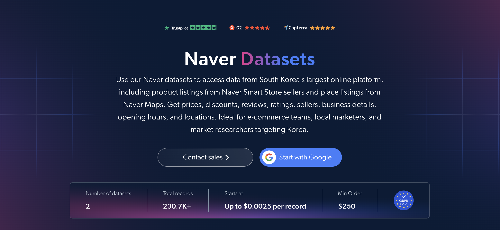

# Naver Smart Store 数据集样本

<h2>包含 1000 个 Naver 商品的示例数据集</h2>

<a href="https://www.bright.cn/products/datasets/naver">
   
</a>

包含 1000 个 Smart Store 商品的 Naver 数据集样本。该数据集通过 <b>Bright Data API</b> 提取。

<h2>该数据集包含的部分数据点：</h2>

* ```url```：Naver 商品页面的 URL
* ```product_id```：每个商品的唯一标识符
* ```title```：商品标题
* ```original_price```：折扣前价格
* ```final_price```：折扣后价格
* ```discount_rate```：商品适用的折扣百分比
* ```currency```：商品价格的货币单位
* ```description```：商品的简短描述或概述
* ```images```：商品图片 URL 列表
* ```breadcrumbs```：商品的分类路径
* ```category_name```：商品所属分类
* ```sold_out```：商品是否售罄
* ```delivery_fee_type```：配送费类型（免费、有条件免费或付费）
* ```free_shipping_minimum```：享受免费配送所需的最低订单金额
* ```arrival_guarantee```：是否提供有保障的快速配送
* ```average_rating```：商品的平均客户评分
* ```total_reviews```：客户评价总数
* ```top_reviews```：热门客户评价，包括评分、内容和媒体
* ```variations```：商品变体，例如尺寸或颜色
* ```sellers```：提供该商品的卖家

以及更多数据点。

这是“Naver 商品（公开数据）”数据集的示例子集，完整数据集包含超过 <b>9,400 个商品</b>。

可用的数据集文件格式：<b>JSON、NDJSON、JSON Lines、CSV、XLSX 或 Parquet。还可选择将文件压缩为 .gz 格式</b>。

数据集交付方式选项：<b>电子邮件、API 下载、Webhook、Amazon S3、Google Cloud Storage、Google Cloud PubSub、Microsoft Azure、Snowflake、SFTP</b>。

更新频率：<b>一次、每日、每周、每月、每季度、每半年或自定义周期</b>。

可在已提取的数据点基础上添加数据增强服务：<b>按需提供。</b>

<b>[获取完整的 Naver 数据集](https://www.bright.cn/products/datasets/naver)</b>。

<a href="https://www.bright.cn/products/datasets/naver">
</a>

<h2>Naver 数据集有哪些应用场景？</h2>

<h3>1. 韩国电商定价</h3>
企业使用 Naver 数据集跟踪 Naver Smart Store 商品列表中的价格和折扣。通过按分类比较原价、最终价格和折扣率，企业可以对标其在韩国市场的定价，并及早发现竞争对手的促销活动。

<h3>2. 卖家与配送分析</h3>
品牌和电商平台团队分析 Naver 数据，对比 Smart Store 卖家的配送费、免运费门槛和送达保障。这有助于了解哪些履约和配送策略能帮助竞争对手赢得韩国消费者。

<h3>3. 评价与口碑跟踪</h3>
企业使用评分、评价数量和热门评价来衡量商品的市场接受度，并了解韩国消费者所看重的因素。监测这些反馈可以揭示商品优势、反复出现的投诉和未被满足的需求，从而为产品开发提供指导。

<h2>面向学术研究人员和 NGO 免费开放网页爬虫工具与数据集</h2>

Bright Initiative 为顶尖院系和学术研究人员，以及推动各类环境与社会事业的 NGO 和 NPO，提供 Bright Data 的 <b>[爬虫工具 API](https://www.bright.cn/products/web-scraper)</b> 和 <b>[即用型数据集](https://www.bright.cn/products/datasets)</b>。你可以在<b>[这里](https://brightinitiative.com)</b>提交申请。
